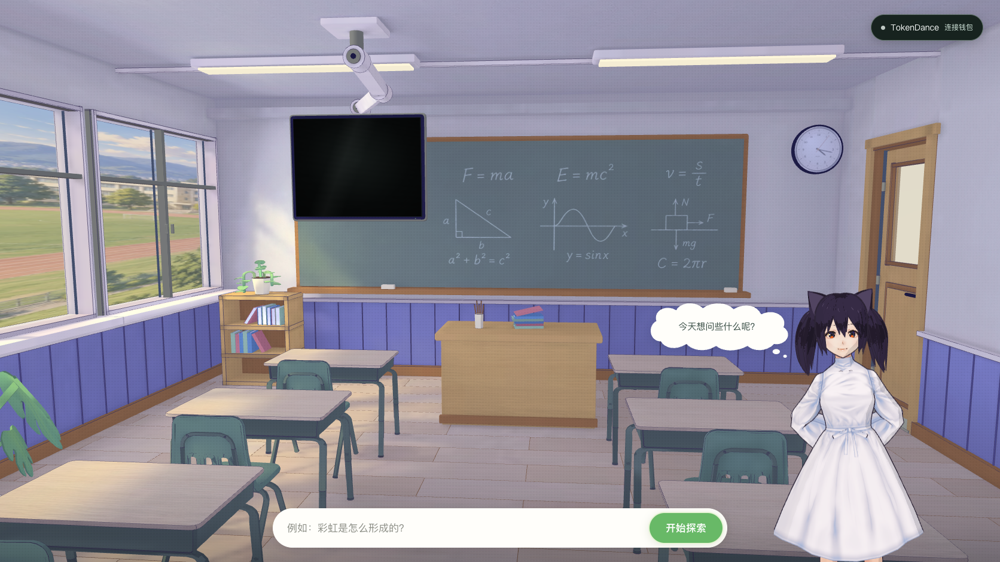

# AI Live Classroom

Turn a question into a short AI-generated video lesson in an interactive 3D classroom.



## Features

- Chinese-language video lessons with follow-up questions.
- An anime-style classroom, 3D mentor and interactive furniture.
- Network-synchronized wall clock and a perspective campus backdrop.
- Personal TokenDance wallet authorization, budget checks and saved lesson playback.

Browsing is free. Generating a lesson requires your own funded TokenDance wallet and may incur charges.

## Run locally

Requires Node.js 22.6 or later.

```bash
git clone https://github.com/LerSent001/ai-live-classroom.git
cd ai-live-classroom
npm ci
cp .env.example .env.local
npm run dev
```

Open [localhost:3000](http://localhost:3000). Connect your wallet in the app when you want to generate a lesson; no shared model key is required.

## Deploy

Use a single persistent Node.js service with HTTPS and writable storage.

```bash
npm run build
npm start
```

Set `TOKENPAY_PUBLIC_URL` to the public HTTPS origin. Keep `.youth-tokenpay/` and `.youth-recordings/` on private persistent storage, outside the public web directory. Never publish environment files, wallet data or recordings.

## Check

```bash
npm run typecheck
npm run lint
npm test
npm run build
npm run verify
```

The verification command uses blank credentials and does not purchase generation.

## Credits

Based on [internetphysics/live-classroom](https://github.com/internetphysics/live-classroom), under the [MIT License](LICENSE). Third-party assets retain their own licenses; see [scene assets](public/youth/SOURCE.md) and [mentor assets](public/youth/models/VRoid-SOURCE.md). Local-only motion packs are not distributed.
